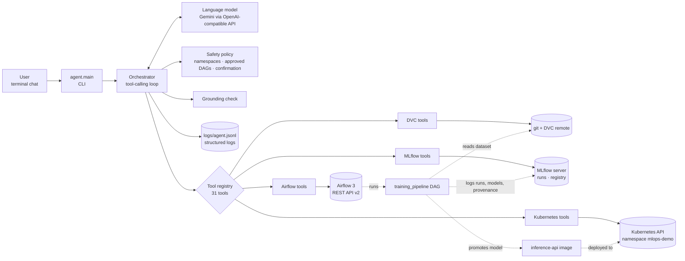
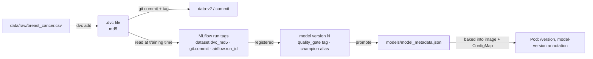

# Architecture

## 1. Overview



The agent never answers operational questions from the model's own knowledge. Every fact in an
answer has to come from a tool result produced during the conversation, and the grounding check
enforces that for numbers and hashes.

## 2. Components

| Component | File | Responsibility |
|---|---|---|
| CLI | `agent/main.py` | chat or single question, terminal confirmations, evidence export |
| Orchestrator | `agent/orchestrator.py` | the loop: model → tool calls → validation → policy → confirmation → execution with timeout → result envelope → model. Grounding check on the final answer. |
| LLM client | `agent/llm.py` | OpenAI-compatible chat completions with tool calling. Request pacing, retries with backoff, fallback models, Gemini thought-signature handling. |
| Schemas | `agent/schemas.py` | `ToolSpec` (name, JSON schema, function, `mutating`, timeout), `ToolResult` (status envelope), `AgentResponse` |
| Safety policy | `agent/safety.py` | namespace allow-list, approved DAGs and parameters, confirmation for state changes |
| Grounding | `agent/grounding.py` | finds values in an answer that do not occur in any tool result |
| Logging | `agent/logging_utils.py` | JSON log lines with request id, tool, status and duration; secrets masked |
| Tools | `agent/tools/*.py` | the four integrations (section 4) |
| Training | `training/` | validate, preprocess, train, evaluate and log, quality gate, promote; provenance capture |
| DAG | `dags/training_pipeline.py` | Airflow 3 orchestration of the training steps with retries |
| Inference API | `api/main.py` | FastAPI service with health, readiness, version and predict endpoints |
| Deployment | `kubernetes/`, `Dockerfile`, `scripts/deploy_k8s.py` | image build, manifests, failure injection |

## 3. Request flow

1. The user's message and the JSON schemas of all tools are sent to the model, together with the
   system prompt that sets the rules (facts only from tools, no state changes unless asked, answer
   format).
2. The model replies with one or more tool calls.
3. For each call the orchestrator:
   * checks the tool exists and the arguments match its schema (`invalid_request` otherwise);
   * for state-changing tools, applies the safety policy first (`denied` if it fails), then asks the
     user to confirm (`denied` if not confirmed);
   * runs the tool in a worker thread with a timeout (`timeout`);
   * maps exceptions to statuses: `ServiceUnavailable` → `unavailable`, `InvalidRequest` →
     `invalid_request`, `PolicyDenied` → `denied`, anything else → `error`;
   * logs one structured line and sends the `ToolResult` back to the model.
4. The model can call more tools or write the final answer.
5. The grounding check extracts metrics, percentages, commit hashes, run ids and md5s from the
   answer and looks each one up in the evidence. Values that are not found are sent back once for
   correction. If they still don't match, they are flagged to the user as unverified.

The result envelope seen by the model:

```json
{"tool": "mlflow_find_best_run", "status": "ok", "data": {"best": {...}, "ranking": [...], "caveats": [...]}, "error": null}
```

## 4. Tools and permissions

State-changing tools are marked **write**. They run only after the policy check passes and the
user confirms.

### DVC (`agent/tools/dvc_tools.py`)
Commands run without a shell, from an allow-list: `git log/show/rev-parse/tag/ls-files/status` and
`dvc status/diff/get/remote list/version`. Revisions are validated against option injection.

| Tool | Access | Purpose |
|---|---|---|
| `dvc_list_tracked_datasets` | read | tracked datasets, hashes, remotes, pipeline |
| `dvc_get_current_version` | read | md5, version tag, commit, workspace matches .dvc? |
| `dvc_dataset_history` | read | every recorded version with commit, tag and md5 |
| `dvc_find_version_by_hash` | read | md5 recorded on an MLflow run → dataset version |
| `dvc_compare_versions` | read | hashes, size difference, `dvc diff` between revisions |
| `dvc_check_status` | read | changed data in the workspace and against the remote |
| `dvc_reproduce_version` | read (writes only to `reproductions/`) | `dvc get` an old version and verify its md5 |

### MLflow (`agent/tools/mlflow_tools.py`), via `MlflowClient`
| Tool | Access | Purpose |
|---|---|---|
| `mlflow_list_experiments` | read | experiments |
| `mlflow_list_runs` | read | runs with metrics, params and provenance tags |
| `mlflow_get_run` | read | one run: tags, artifacts, registered versions |
| `mlflow_find_best_run` | read | ranking by metric, preferring runs that passed the quality gate, with caveats |
| `mlflow_compare_runs` | read | side-by-side runs, best per metric |
| `mlflow_compare_experiments` | read | best and mean metric per experiment |
| `mlflow_get_model_registry` | read | versions, aliases, gate tags |
| `mlflow_check_model_freshness` | read | champion age and metrics against the retraining policy |

### Airflow (`agent/tools/airflow_tools.py`), via REST API v2 with a JWT from `/auth/token`
| Tool | Access | Purpose |
|---|---|---|
| `airflow_list_dags` | read | DAGs, paused state, approved for trigger? |
| `airflow_get_dag_runs` | read | recent runs and their states |
| `airflow_trigger_dag` | **write** | approved DAGs only, known parameters only, confirmation required |
| `airflow_wait_for_dag_run` | read | poll until the run finishes, then task states |
| `airflow_get_task_instances` | read | task states, tries, durations |
| `airflow_get_failed_tasks` | read | failed tasks with exception, message and code location from the logs; blocked downstream tasks |
| `airflow_get_task_logs` | read | condensed log of a task try |

### Kubernetes (`agent/tools/kubernetes_tools.py`), via the official Python client
Every call, reads included, must target a namespace in `K8S_ALLOWED_NAMESPACES`.

| Tool | Access | Purpose |
|---|---|---|
| `k8s_list_deployments` | read | replicas, images, conditions |
| `k8s_list_pods` | read | phase, readiness, restarts, container reasons |
| `k8s_get_pod_logs` | read | log tail, optionally of the previous container |
| `k8s_list_services` | read | ports, selector, ready endpoints (0 = not serving) |
| `k8s_get_events` | read | warnings such as probe failures and back-offs |
| `k8s_find_unhealthy_pods` | read | combined health diagnosis |
| `k8s_get_deployed_version` | read | image, app version, model version, revision, ConfigMap |
| `k8s_restart_deployment` | **write** | rolling restart (confirmation, approved namespace) |
| `k8s_scale_deployment` | **write** | 0 to 5 replicas (confirmation, approved namespace) |

On a shared cluster the agent should run as the `mlops-agent` ServiceAccount in
`kubernetes/agent-rbac.yaml`: read access to the namespace, plus patch on deployments and
`deployments/scale` only.

## 5. Provenance chain



Questions like *"which dataset trained the deployed model?"* are answered by walking this chain
backwards: Kubernetes model version → MLflow version → run tag `dataset.dvc_md5` →
`dvc_find_version_by_hash` → git tag and commit.

## 6. Training pipeline

```
validate_data → preprocess → train_model → evaluate_and_log → quality_gate → promote_model
```

* `retries=2`, `retry_delay=30s` with exponential backoff, for transient failures (for example
  MLflow briefly unreachable).
* Validation and quality-gate failures raise `AirflowFailException`. They fail immediately without
  retries, because bad data or a weak model will not improve on retry.
* Training writes `models/candidate.joblib`. Only `promote_model`, which runs after the gate passes,
  copies it to `models/model.joblib`, so a model that failed the gate can never be deployed.
* Failed gates are tagged on the MLflow run and the model version (`quality_gate=failed` plus the
  reason).

## 7. Design decisions

| Decision | Reason |
|---|---|
| Direct tool calling instead of an agent framework | full control over validation, policy, confirmation, timeouts and logging; fewer dependencies; behaviour is easy to test with a scripted model |
| OpenAI-compatible client | one code path for Gemini, OpenAI, Groq and local models; the provider is a setting |
| Policy enforced in code, not only in the prompt | prompts can be ignored; the namespace and DAG allow-lists and confirmations cannot |
| Grounding check | catches invented metrics and hashes, the most damaging failure for an operations assistant |
| `dvc get` for reproduction | proves a past version can be restored, without modifying the user's working copy |
| Airflow 3 standalone in Docker | one container is enough for a local demo; the REST API is the same as in production |
| MLflow 3 with `--allowed-hosts` | MLflow 3 rejects unknown Host headers by default, and Airflow reaches it as `mlflow:5000` |
| Model baked into the API image | the deployment is self-contained and reproducible; the version is visible via `/version`, the ConfigMap and the pod annotation |
| Liveness separate from readiness | a missing model makes pods *not ready* (no traffic) instead of restarting them in a loop, which makes the failure diagnosable |
| Non-root container, read-only root filesystem, resource limits | basic production hardening |
