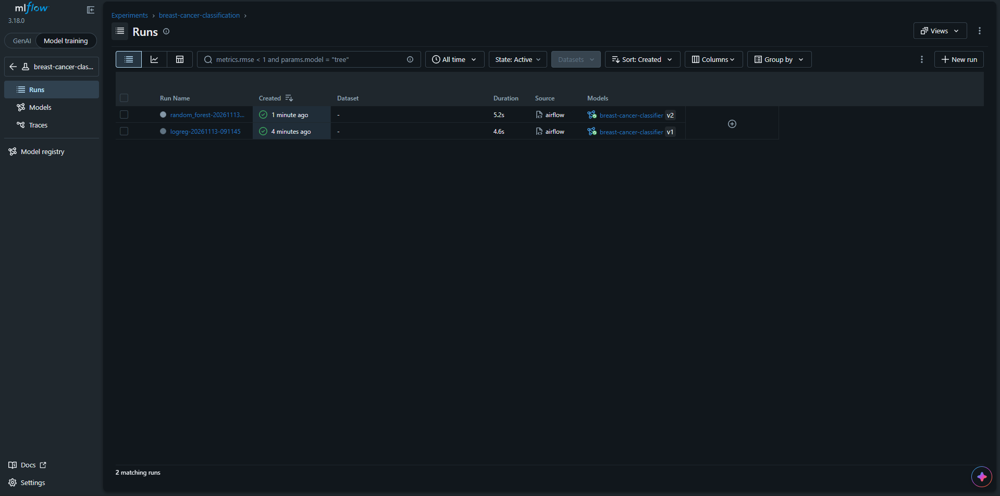

# Technical Report: MLOps Operations Agent

**Course:** MLOps & Production AI Engineering, Assignment 03
**Repository:** see README for installation and usage

> Sections marked **[evidence]** are filled from real runs: screenshots go in `screenshots/`, and
> agent conversations are generated with `python scripts/run_scenarios.py` into `evidence/`.

---

## 1. System architecture

The system has five parts (full detail in [architecture.md](../architecture.md)):

1. **Data layer:** the breast-cancer dataset, versioned with DVC (`data-v1`: 400 rows,
   `data-v2`: 569 rows). The CSV lives in DVC storage; git holds the `.dvc` file with its md5.
2. **Training pipeline:** an Airflow 3 DAG `validate_data → preprocess → train_model →
   evaluate_and_log → quality_gate → promote_model`. It logs every run to MLflow with the dataset
   md5, git commit and Airflow run id as tags, and registers the model.
3. **Model registry:** MLflow 3 with the `champion` alias pointing at the last version that passed
   the quality gate.
4. **Serving:** a FastAPI service in a container, deployed to Kubernetes (Docker Desktop) as a
   2-replica Deployment with readiness and liveness probes, resource limits, a ConfigMap and a
   ClusterIP Service.
5. **Agent:** a tool-calling loop over 31 tools in four modules (DVC, MLflow, Airflow, Kubernetes),
   with a safety policy, user confirmation for state changes, a grounding check and structured
   logging.

Data flows forward from dataset to deployed pod. The agent answers questions by walking the
provenance chain backwards: deployed model version → MLflow run → dataset md5 → DVC version → git
commit.

## 2. Tool definitions and permissions

| Module | Tools | Reads | Writes (confirmation required) |
|---|---|---|---|
| DVC | 7 | dataset list, current version, history, hash lookup, compare, status, reproduce (`dvc get` into `reproductions/`) | none |
| MLflow | 8 | experiments, runs, run details, best run, compare runs and experiments, registry, freshness | none |
| Airflow | 7 | DAGs, runs, task instances, failed tasks with root cause, task logs, wait for run | `airflow_trigger_dag` (approved DAGs and parameters only) |
| Kubernetes | 9 | deployments, pods, logs, services and endpoints, events, unhealthy pods, deployed version | `k8s_restart_deployment`, `k8s_scale_deployment` |

Controls enforced in code (`agent/safety.py`, `agent/orchestrator.py`):

* **Namespace allow-list** (`mlops-demo`) for every Kubernetes call, reads included.
* **Approved DAG list** (`training_pipeline`) and **allowed run parameters** for triggering.
* **Explicit confirmation** in the terminal for every state change. Non-interactive runs refuse all
  of them.
* **Command allow-list** for git and DVC, executed without a shell.
* **Least-privilege RBAC** for the agent on shared clusters (`kubernetes/agent-rbac.yaml`).
* **Secrets** come only from environment variables. Logs mask passwords, tokens and keys. The
  Airflow password is written into the container at start-up and is never stored in the repository.
* **No automatic retraining:** the system prompt forbids state changes the user did not ask for,
  and the confirmation step enforces it.

## 3. Evidence from each system [evidence]

Take these screenshots after completing the setup in the README, and save them in `screenshots/`:

| File | What to show |
|---|---|
| `screenshots/dvc_versions.png` | terminal: `git tag`, `git log --oneline -- data/raw/breast_cancer.csv.dvc`, `dvc status` |
| `screenshots/dvc_reproduce.png` | terminal: `dvc get . data/raw/breast_cancer.csv --rev data-v1 -o reproductions/v1.csv` and the md5 check |
| `screenshots/mlflow_runs.png` | MLflow UI: experiment `breast-cancer-classification`, runs table with f1 and the `quality_gate` tag |
| `screenshots/mlflow_registry.png` | MLflow UI: model `breast-cancer-classifier` versions with the `champion` alias |
| `screenshots/airflow_dag_success.png` | Airflow UI: `training_pipeline` graph with all six tasks green |
| `screenshots/airflow_dag_failed.png` | Airflow UI: the run with `inject_failure=bad_data`, `validate_data` red, the rest blocked |
| `screenshots/k8s_healthy.png` | terminal: `kubectl -n mlops-demo get deploy,pods,svc,endpoints` with 2/2 ready |
| `screenshots/k8s_version.png` | terminal: `curl http://localhost:8000/version` through port-forward |
| `screenshots/k8s_failure.png` | terminal: pods 0/1 ready after `--inject missing-model` |

<!-- Replace each line below with the screenshot once taken, e.g.  -->

## 4. Agent conversations [evidence]

Generated with `python scripts/run_scenarios.py`. Each file contains the question, the agent's full
answer and the raw result of every tool call it made.

| # | Scenario | Evidence file | Tools used | Outcome |
|---|---|---|---|---|
| 1 | Dataset provenance | `evidence/01_dataset_provenance.md` | *(fill in from the file)* | |
| 2 | Model selection (last five runs, F1) | `evidence/02_model_selection.md` | | |
| 3 | Pipeline execution | `evidence/03_pipeline_execution.md` | | |
| 4 | Deployment diagnosis | `evidence/04_deployment_diagnosis.md` | | |
| 5 | Multi-tool reasoning (mandatory scenario) | `evidence/05_multi_tool.md` | | |

For each one, add a short summary below: what was asked, which tools the agent chose and in which
order, and whether the answer matched the systems. Check the answer against the UI or `kubectl`.

## 5. Mandatory integration scenario

*"Find the best recent model, identify the dataset version used to train it, check the deployment
status, and explain whether retraining is necessary."*

Expected tool sequence and how each step uses the previous one:

1. `mlflow_find_best_run`: best run among recent runs, preferring runs that passed the gate. Gives
   the run's `dataset.dvc_md5` tag.
2. `dvc_find_version_by_hash`: that md5 → dataset tag and commit.
3. `dvc_get_current_version`: is newer data available than the model was trained on?
4. `k8s_find_unhealthy_pods` and `k8s_get_deployed_version`: is the API healthy, and which model
   version is it serving?
5. `airflow_get_dag_runs`: status of recent training runs.
6. `mlflow_check_model_freshness`: champion age and metrics against the policy (30 days, F1 ≥ 0.90).
7. Correlation: retraining is recommended only if the policy is exceeded, the latest gate failed, the
   deployed model was trained on older data than the current version, or degradation data is
   supplied. Retraining is **never triggered** from this request.

Result: see `evidence/05_multi_tool.md` **[evidence]**.

## 6. Failure investigations

### 6.1 Injected failure: corrupted training data (Airflow)

* **Injection:** trigger `training_pipeline` with run parameters `{"inject_failure": "bad_data"}`.
  The validation step simulates a corrupted upstream extract by dropping the target column.
* **Symptom:** the DAG run fails within seconds. No new model is registered.
* **Agent investigation:** `airflow_get_dag_runs` → `airflow_get_failed_tasks`. The tool reads the
  task's structured log and extracts the exception, the message and the code location.
* **Root cause:** `validate_data` raised `AirflowFailException: data validation failed: missing
  target column 'target'` (`training/steps.py`, `validate`). It failed on the first try with no
  retries. All five downstream tasks were `upstream_failed`.
* **Resolution:** fix the data source (here: trigger without `inject_failure`). The bad data never
  reached training or promotion, and the deployed model was untouched.
* **Agent output:** paste from `evidence/06_failure_airflow.md` **[evidence]**

### 6.2 Injected failure: prediction API unavailable (Kubernetes)

* **Injection:** `python scripts/deploy_k8s.py --inject missing-model` changes `MODEL_PATH` in the
  ConfigMap to a file that does not exist in the image, then restarts the deployment.
* **Symptom:** the Deployment shows 0/2 ready, and requests to the Service fail.
* **Agent investigation:** `k8s_find_unhealthy_pods` (pods Running but not ready, readiness-probe
  warnings in events) → `k8s_list_services` (0 ready endpoints) → `k8s_get_pod_logs` (error line)
  → `k8s_get_deployed_version` (ConfigMap shows the wrong `MODEL_PATH`).
* **Root cause:** the API cannot load `/app/models/model-v2.joblib`. `/health/ready` returns 503, so
  Kubernetes keeps the pods out of the Service and nothing serves traffic. `/health/live` still
  returns 200, so the pods are not restarted in a loop. This was a deliberate design choice that
  keeps the error visible in the logs.
* **Resolution:** `python scripts/deploy_k8s.py --restore` restores the ConfigMap and restarts the
  deployment.
* **Agent output:** paste from `evidence/04_deployment_diagnosis.md` (run after the injection)
  **[evidence]**

### 6.3 Unexpected failures found while building the system

These were not planned. They were diagnosed and fixed during development:

1. **MLflow rejected requests from Airflow (HTTP 403).** MLflow 3's security middleware accepts
   only `localhost` Host headers by default, but inside Docker Compose Airflow addresses the server
   as `mlflow:5000`. *Diagnosis:* a request with `Host: mlflow:5000` returned 403 while `localhost`
   returned 200. *Fix:* `--allowed-hosts` in `docker-compose.yml`; unknown hosts are still rejected.
2. **`evaluate_and_log` failed three times with `ModuleNotFoundError: No module named 'skops'`.**
   MLflow 3 saves scikit-learn models with `skops`, which the slim `mlflow-skinny` package used in
   the Airflow image does not include. *Diagnosis:* `airflow_get_failed_tasks` extracted the
   exception from the task log, and the retries showed it was not transient. *Fix:* add `skops` to
   `docker/airflow.Dockerfile`.
3. **Random-forest models could not be logged** (`untrusted types: sklearn.tree._tree.Tree`).
   *Fix:* trust that one type explicitly in `log_model`, since this pipeline creates the models
   itself.
4. **A failed model could have replaced the deployed one.** Training originally wrote straight to
   `models/model.joblib`, before the quality gate ran. *Fix:* training writes `candidate.joblib`, and
   only `promote_model`, which runs after the gate passes, copies it.

## 7. Testing and reliability

38 automated tests (`pytest`), running in CI on every pull request. Highlights:

| Requirement | Test |
|---|---|
| Correct tool selection and execution | `test_orchestrator.py::test_selects_and_executes_the_requested_tool`, `test_multi_tool_request_collects_evidence_from_each_system` |
| Mocked unavailable services | `test_unavailable_service_is_reported_not_invented`, `test_unreachable_*` in the tool tests |
| Timeouts, invalid requests, service failures | `test_tool_timeout_is_reported`, `test_invalid_requests_are_rejected_without_crashing`, `test_unexpected_tool_crash_becomes_error_result` |
| Does not invent results when a tool is unavailable | `test_unavailable_service_is_reported_not_invented`, `test_fabricated_values_are_flagged_when_model_does_not_correct` |
| Unauthorised Kubernetes changes rejected | `test_safety.py::test_restart_outside_approved_namespace_is_rejected`, `test_restart_without_confirmation_is_rejected`, `test_non_interactive_default_denies_every_change` |
| Structured logs without secrets | `test_structured_logs_have_required_fields_and_no_secrets` |
| Pipeline guards | `test_validation_passes_on_good_data_and_blocks_bad_data`, `test_quality_gate_blocks_weak_models` |
| DVC provenance | `test_dvc_tools.py` (real temporary git and DVC repository) |

## 8. Known limitations and proposed improvements

| Limitation | Proposed improvement |
|---|---|
| No production monitoring: model degradation is unknown unless supplied | log prediction statistics from the API and add a drift check (for example on feature distributions) as a tool and a retraining trigger condition |
| Model baked into the image: a new model needs an image rebuild | load the `champion` model from the MLflow registry at start-up, or use an init container |
| Airflow runs in standalone mode with SQLite | use the official multi-container setup with PostgreSQL and the CeleryExecutor or KubernetesExecutor |
| DVC remote is a local folder | an S3 or GCS remote with restricted credentials, so CI and other machines can `dvc pull` |
| Grounding check covers numbers and hashes only, not every claim | add a check that every named run, version or pod appears in the evidence |
| One conversation at a time in the terminal | serve the agent behind an authenticated API with per-user permissions and audit logs |
| The agent uses the user's kubeconfig locally | run it with the `mlops-agent` ServiceAccount everywhere |
| The deployment is not updated automatically after promotion | a CD step (for example Argo CD) that rolls out the new image when the `champion` alias changes, gated on smoke tests |
