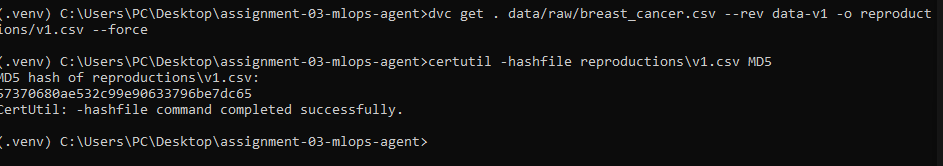
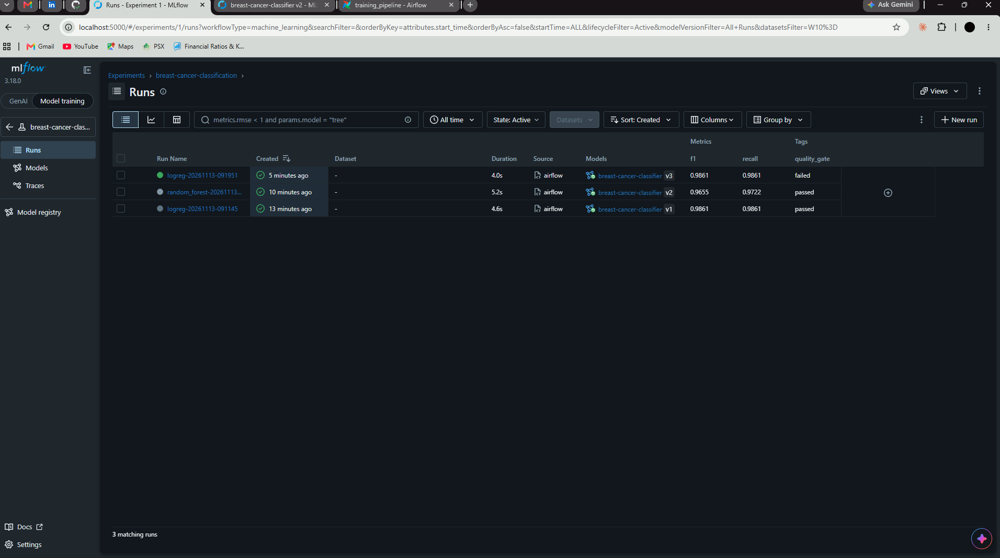
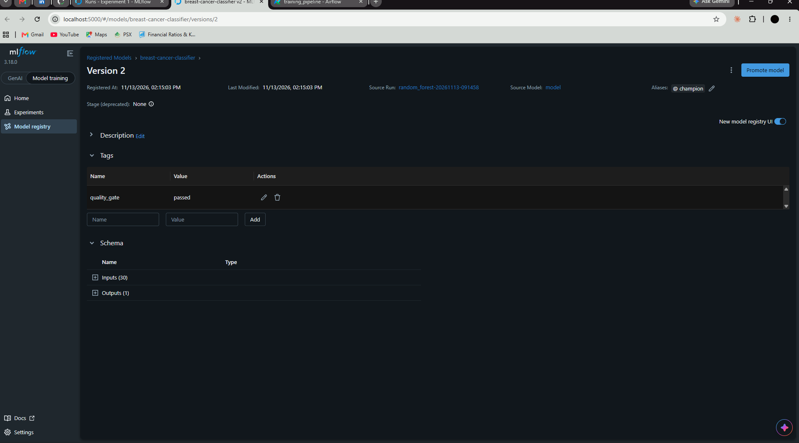
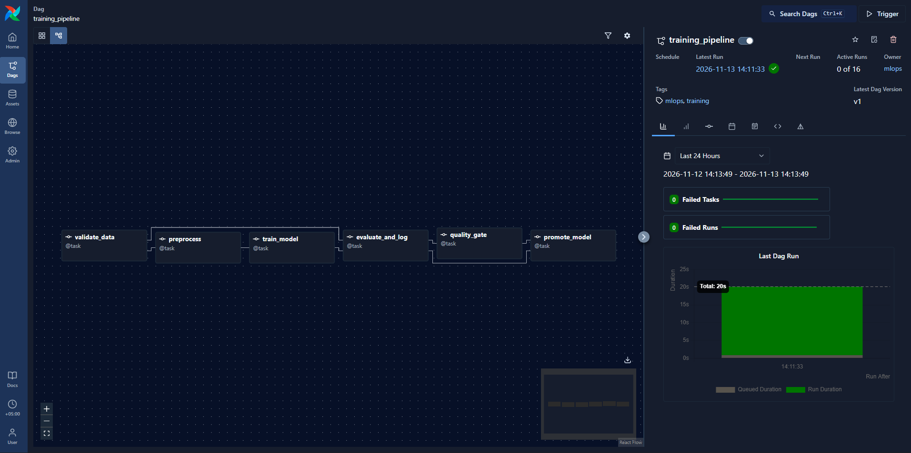
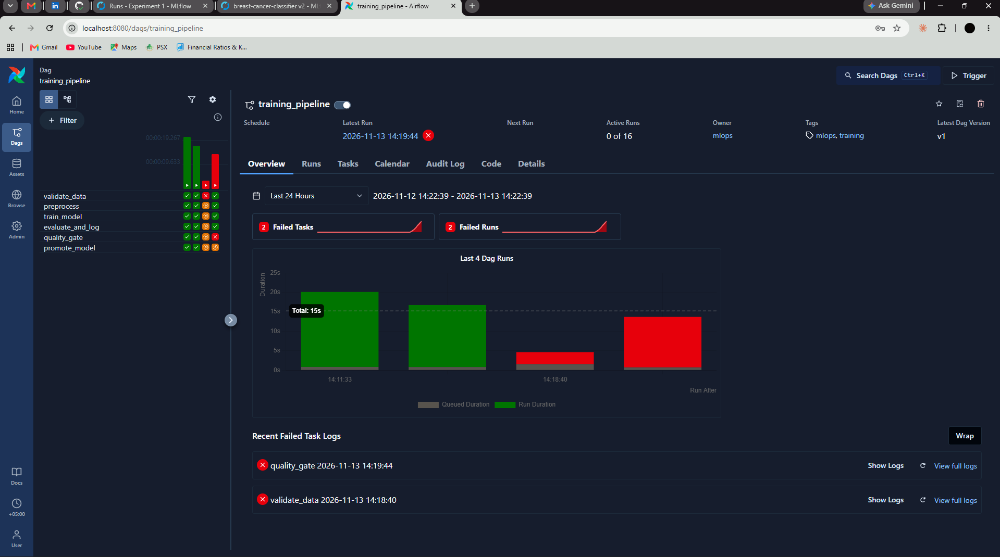
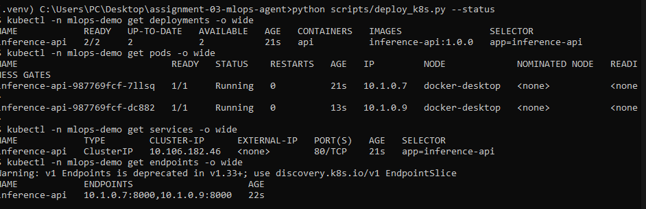
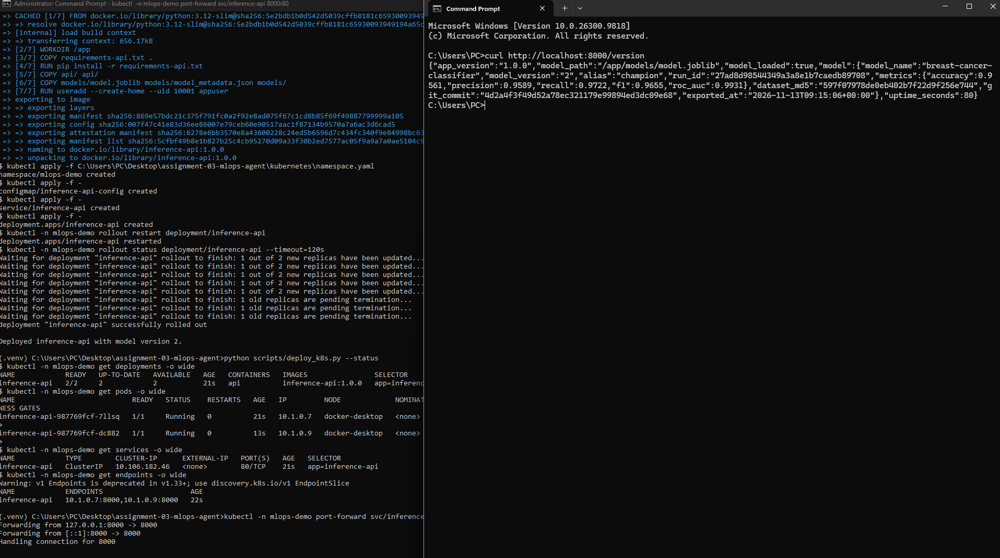
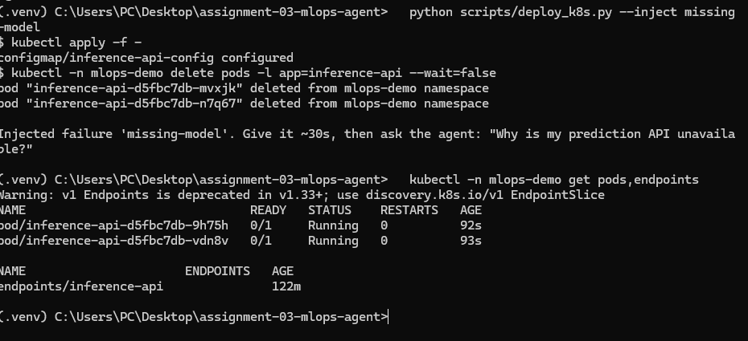

# Technical Report: MLOps Operations Agent

**Course:** MLOps, Assignment 03
**Repository:** see README for installation and usage

> All results below come from real runs on 13 November 2026: Docker Desktop on Windows 11 with
> Kubernetes v1.36.1 (kubeadm, one node), Airflow 3.3.2, MLflow 3.18.0 and DVC 3.67.1. The agent used
> Gemini (`gemini-3.5-flash`, switching automatically to `gemini-3.5-flash-lite` when the free-tier
> daily quota ran out). Screenshots are in `screenshots/`; full conversations with every raw tool
> result are in `evidence/`.

---

## 1. System architecture

The system has five parts (full detail in [architecture.md](../architecture.md)):

1. **Data layer:** the breast-cancer dataset, versioned with DVC (`data-v1`: 400 rows,
   `data-v2`: 569 rows). The CSV lives in DVC storage; git holds the `.dvc` file with its md5.
2. **Training pipeline:** an Airflow 3 DAG `validate_data → preprocess → train_model →
   evaluate_and_log → quality_gate → promote_model`. It logs every run to MLflow with the dataset
   md5, git commit and Airflow run id as tags, and registers the model.
3. **Model registry:** MLflow 3 with the `champion` alias pointing at the last version that passed
   the quality gate.
4. **Serving:** a FastAPI service in a container, deployed to Kubernetes (Docker Desktop) as a
   2-replica Deployment with readiness and liveness probes, resource limits, a ConfigMap and a
   ClusterIP Service.
5. **Agent:** a tool-calling loop over 31 tools in four modules (DVC, MLflow, Airflow, Kubernetes),
   with a safety policy, user confirmation for state changes, a grounding check and structured
   logging.

Data flows forward from dataset to deployed pod. The agent answers questions by walking the
provenance chain backwards: deployed model version → MLflow run → dataset md5 → DVC version → git
commit.

## 2. Tool definitions and permissions

| Module | Tools | Reads | Writes (confirmation required) |
|---|---|---|---|
| DVC | 7 | dataset list, current version, history, hash lookup, compare, status, reproduce (`dvc get` into `reproductions/`) | none |
| MLflow | 8 | experiments, runs, run details, best run, compare runs and experiments, registry, freshness | none |
| Airflow | 7 | DAGs, runs, task instances, failed tasks with root cause, task logs, wait for run | `airflow_trigger_dag` (approved DAGs and parameters only) |
| Kubernetes | 9 | deployments, pods, logs, services and endpoints, events, unhealthy pods, deployed version | `k8s_restart_deployment`, `k8s_scale_deployment` |

Controls enforced in code (`agent/safety.py`, `agent/orchestrator.py`):

* **Namespace allow-list** (`mlops-demo`) for every Kubernetes call, reads included.
* **Approved DAG list** (`training_pipeline`) and **allowed run parameters** for triggering.
* **Explicit confirmation** in the terminal for every state change. Non-interactive runs refuse all
  of them.
* **Command allow-list** for git and DVC, executed without a shell.
* **Least-privilege RBAC** for the agent on shared clusters (`kubernetes/agent-rbac.yaml`).
* **Secrets** come only from environment variables. Logs mask passwords, tokens and keys. The
  Airflow password is written into the container at start-up and is never stored in the repository.
* **No automatic retraining:** the system prompt forbids state changes the user did not ask for,
  and the confirmation step enforces it.

## 3. Evidence from each system

### 3.1 DVC: dataset versions and reproduction

| Tag | Commit | Rows | Size | DVC md5 |
|---|---|---|---|---|
| `data-v1` | `6906f32` | 400 | 84,760 bytes | `57370680ae532c99e90633796be7dc65` |
| `data-v2` | `32186cc` | 569 | 120,381 bytes | `597f07978de0eb402b7f22d9f256e744` |


Reproducing the older version without touching the workspace:

```
dvc get . data/raw/breast_cancer.csv --rev data-v1 -o reproductions/v1.csv
certutil -hashfile reproductions\v1.csv MD5   ->  57370680ae532c99e90633796be7dc65
```

The hash of the restored file matches the md5 recorded in git for `data-v1`, so the old version is
reproducible byte for byte from DVC storage.



`dvc repro` runs the offline training stage and records it in `dvc.lock` and `metrics.json`
(logistic regression on data-v2: accuracy 0.9825, F1 0.9861, ROC-AUC 0.9954).

### 3.2 MLflow: runs, quality gate and registry

| Run | Model | F1 | Recall | Quality gate | Registry |
|---|---|---|---|---|---|
| `logreg-20261113-091145` | logistic regression | 0.9861 | 0.9861 | passed | v1 |
| `random_forest-20261113-091458` | random forest | 0.9655 | 0.9722 | passed | v2 (`champion` at the time of scenarios 1, 2 and 5) |
| `logreg-20261113-091951` | logistic regression, `min_f1=0.9999` | 0.9861 | 0.9861 | **failed** | v3, never promoted |
| run from scenario 3 | logistic regression | 0.9861 | 0.9861 | passed | v4 (`champion` afterwards, deployed) |

Every run carries the tags `dataset.dvc_md5`, `git.commit` and `airflow.run_id`.





### 3.3 Airflow: successful and failed runs

Successful runs take about 15 to 20 seconds for all six tasks. The two injected failures fail fast
and block everything downstream:

* `inject_failure=bad_data`: `validate_data` fails, the other five tasks are `upstream_failed`.
* `min_f1=0.9999`: the first four tasks succeed, `quality_gate` fails, `promote_model` never runs. The
  model is logged and registered for traceability (v3) but does not become `champion`.




### 3.4 Kubernetes: healthy deployment, deployed version, injected failure

`python scripts/deploy_k8s.py` built `inference-api:1.0.0`, applied the manifests to `mlops-demo` and
waited for the rollout: Deployment 2/2 ready, two pods `1/1 Running`, Service with two endpoints.
`GET /version` through `kubectl port-forward` returns the app version and the model version that is
baked into the image.




After `--inject missing-model`, both pods are `0/1` and the Service has no endpoints (section 6.2).



## 4. Agent conversations

Generated with `python scripts/run_scenarios.py`. Each file contains the question, the full answer and
the raw result of every tool call. Every answer was checked against the UIs and `kubectl`.

| # | Scenario | Evidence file | Tools, in the order the agent called them | Outcome |
|---|---|---|---|---|
| 1 | Dataset provenance | `evidence/01_dataset_provenance.md` | `mlflow_get_model_registry` → `mlflow_get_run` → `dvc_find_version_by_hash` → `dvc_compare_versions` → `dvc_reproduce_version` | correct: champion v2 → md5 `597f0797…` → `data-v2` at `32186cc`; +35,621 bytes over `data-v1`; reproduction verified by md5 |
| 2 | Model selection (last five runs, F1) | `evidence/02_model_selection.md` | `mlflow_list_runs` → `mlflow_find_best_run` | correct: ranked all runs, skipped the top-F1 run because it failed the gate, recommended `0898bb7e…`; stated that only 3 runs existed |
| 3 | Pipeline execution | `evidence/03_pipeline_execution.md` | `airflow_list_dags` → `airflow_trigger_dag` (confirmed with `y`) → `airflow_wait_for_dag_run` | correct: run `success`, all six tasks `success` |
| 4 | Deployment diagnosis | `evidence/04_deployment_diagnosis.md` | `k8s_find_unhealthy_pods` → `k8s_list_services` → `k8s_get_deployed_version` → `k8s_get_pod_logs` | correct root cause: `model file not found at /app/models/model-v2.joblib`, 0 ready endpoints |
| 5 | Multi-tool reasoning (mandatory scenario) | `evidence/05_multi_tool.md` | `mlflow_find_best_run` → `mlflow_check_model_freshness` → `dvc_get_current_version` → `k8s_get_deployed_version` → `k8s_find_unhealthy_pods` → `airflow_get_dag_runs` | correct conclusion from all four systems, see section 5 |
| 6 | Pipeline failure investigation | `evidence/06_failure_airflow.md` | `airflow_list_dags` → `airflow_get_dag_runs` → `airflow_get_failed_tasks` | correct, see section 6.1 |

**1. Dataset provenance.** The agent started from the registry, not from the dataset: it found the
`champion` alias (v2), read that run's `dataset.dvc_md5` tag and mapped the hash back to `data-v2` and
its commit. It then compared with `data-v1` and reproduced the version with `dvc get`, reporting the
verified md5. On the first attempt the two DVC tools failed (section 6.3, issue 5); the agent listed
them under *Uncertainties* and gave the manual commands instead of inventing a comparison.

**2. Model selection.** The question asked for five runs; only three existed, and the agent said so.
Two runs tie on F1 (0.9861), but one failed the quality gate (`f1 0.9861 < 0.9999`), so the agent
recommended the run that passed. This is the behaviour `mlflow_find_best_run` is designed for: it
ranks by the metric but prefers gate-passed runs and returns caveats.

**3. Pipeline execution.** The trigger is the only state change in the scenarios. The terminal asked
*Allow? [y/N]* before the call, and the run was only started after confirmation. The agent then
waited for the run to finish and reported the state of each task rather than assuming success.

**4. Deployment diagnosis.** The agent separated the symptom (pods `Running` but `0/1` ready, no
endpoints) from the cause (start-up error in the logs) and linked it to the configured
`MODEL_PATH`. One weakness: its recommendation suggests rebuilding the image with a file at that
path, when the actual fix is to restore the ConfigMap. Its facts were correct; the remedy was only
half right.

**5. Multi-tool reasoning.** See section 5.

## 5. Mandatory integration scenario

*"Find the best recent model, identify the dataset version used to train it, check the deployment
status, and explain whether retraining is necessary."*

The agent used all four systems in one answer, calling six tools:

1. `mlflow_find_best_run`: best gate-passed run `36c3e205…` (`logreg-20261113-100750`, F1 0.9861),
   with its `dataset.dvc_md5` tag.
2. `mlflow_check_model_freshness`: champion age 0.1 days against the 30-day policy, F1 above the
   0.90 minimum, `retraining_indicated_by_policy: false`.
3. `dvc_get_current_version`: the workspace dataset is `data-v2` with md5 `597f0797…`, the same
   hash recorded on the run, so the model was trained on the latest data.
4. `k8s_get_deployed_version`: Deployment `inference-api` in `mlops-demo`, 2/2 ready, serving
   model version 4.
5. `k8s_find_unhealthy_pods`: no unhealthy pods; only older readiness-probe warnings from the
   injected failure.
6. `airflow_get_dag_runs`: recent training runs, including the successful run from scenario 3 and
   the two injected failures.

**Conclusion given by the agent:** retraining is not necessary. The champion is fresh, passes the
gate, was trained on the current dataset version and is healthy in Kubernetes. The agent noted that
no production drift or degradation data exists, so that criterion could not be checked. It did
**not** trigger a run.

**Weakness.** The agent fetched the Airflow runs but did not mention them in its answer. The most
recent run had failed (the injected `bad_data` run), which was worth stating, even though it does
not change the conclusion because that failure was in data validation, not in the deployed model.
The evidence file contains the full Airflow result.

**A real finding from the earlier run of this scenario** (before scenario 3 promoted v4). The
deployed champion was v2 (random forest, F1 0.9655), while an older gate-passing logistic
regression run had F1 0.9861. The pipeline promotes the *latest* model that passes the gate, not the
*best* one. The agent picked this up and suggested considering the better run for promotion. See
section 8. The first run also used only three systems; the instructions to the agent now require
Airflow, MLflow, DVC and Kubernetes for retraining questions.

## 6. Failure investigations

### 6.1 Injected failure: corrupted training data (Airflow)

* **Injection:** trigger `training_pipeline` with run parameters `{"inject_failure": "bad_data"}`.
  The validation step simulates a corrupted upstream extract by dropping the target column.
* **Symptom:** the DAG run fails within seconds. No new model is registered.
* **Agent investigation:** `airflow_list_dags` → `airflow_get_dag_runs` → `airflow_get_failed_tasks`.
  The last tool reads the task's structured Airflow 3 log and extracts the exception, the message and
  the code location.
* **Root cause:** `validate_data` raised `AirflowFailException: data validation failed: missing
  target column 'target'` (`training/steps.py`, `validate`). It failed on the first try with no
  retries. All five downstream tasks were `upstream_failed`.
* **Resolution:** fix the data source (here: trigger without `inject_failure`). The bad data never
  reached training or promotion, and the deployed model was untouched.
* **Agent output** (`evidence/06_failure_airflow.md`, run `manual__2026-11-13T10:08:45`):

  > * Failed task: `validate_data` in DAG run `manual__2026-11-13T10:08:45.938443+00:00` of the
  >   `training_pipeline` DAG.
  > * Root cause: Data validation failed because the target column ('target') was missing
  >   (`ValidationError: data validation failed: missing target column 'target'`), intentionally
  >   simulated via configuration parameter `inject_failure=bad_data` dropping the target column.
  > * Blocked downstream tasks: `preprocess`, `train_model`, `evaluate_and_log`, `quality_gate`,
  >   and `promote_model`.
  > * Recommended action: re-run the pipeline without the `inject_failure` parameter.

### 6.2 Injected failure: prediction API unavailable (Kubernetes)

* **Injection:** `python scripts/deploy_k8s.py --inject missing-model` changes `MODEL_PATH` in the
  ConfigMap to a file that does not exist in the image, then deletes the pods so that their
  replacements read the broken configuration (as after a node restart or an eviction).
* **Symptom:** both pods `Running` but `0/1` ready, Service `inference-api` with no endpoints, so
  every request fails.
* **Agent investigation:** `k8s_find_unhealthy_pods` (both pods not ready, readiness probe returns
  503) → `k8s_list_services` (0 ready, 2 not-ready endpoints) → `k8s_get_deployed_version`
  (configured `MODEL_PATH` is `/app/models/model-v2.joblib`) → `k8s_get_pod_logs` (start-up error).
* **Root cause:** the API cannot load `/app/models/model-v2.joblib`. `/health/ready` returns 503, so
  Kubernetes keeps the pods out of the Service. `/health/live` still returns 200, so the pods are
  not restarted in a loop. This keeps the error visible in the logs.
* **Resolution:** `python scripts/deploy_k8s.py --restore` restores the ConfigMap, rebuilds the image
  and rolls the deployment out again (2/2 ready).
* **Agent output** (`evidence/04_deployment_diagnosis.md`):

  > - Total pods for `inference-api` is 2, and both are unhealthy (`ready: 0/1`) with readiness probe
  >   failing due to HTTP status code 503.
  > - The `inference-api` service has 0 ready endpoints and 2 not-ready endpoints, meaning it cannot
  >   serve traffic.
  > - The deployment is configured to load a model file at `/app/models/model-v2.joblib`.
  > - Pod logs show an explicit error on startup: `model file not found at /app/models/model-v2.joblib`.

**How this investigation had to be fixed twice before it worked:**

1. *The first injection did not take the API down.* The Deployment uses `maxUnavailable: 0`, so the
   rolling update started one new pod with the broken configuration, saw it never became ready, and
   kept both old pods serving. The agent correctly answered that the API was *degraded, not down*:
   one of three pods was not ready and the Service still had two endpoints. This shows the rollout
   strategy protecting availability, but it was not the outage I wanted to demonstrate. The
   injection now deletes the pods so that every replacement starts with the bad configuration.
2. *The agent could not see the root cause.* Its log tool returned the last 50 lines, and the
   readiness and liveness probes write an access-log line every few seconds. Within a minute the
   start-up error had scrolled out of the window, and the agent only saw `GET /health/ready 503`. It
   reported the cause as unknown instead of guessing, which is the correct behaviour, but the tool
   was not useful. `k8s_get_pod_logs` now reads further back, reduces probe lines to counts (for
   example `"/health/ready 503": 12`) and keeps the other lines. A test reproduces the case with
   300 probe lines behind one start-up error.

### 6.3 Unexpected failures found while building and running the system

These were not planned. They were diagnosed and fixed during development:

1. **MLflow rejected requests from Airflow (HTTP 403).** MLflow 3's security middleware accepts
   only `localhost` Host headers by default, but inside Docker Compose Airflow addresses the server
   as `mlflow:5000`. *Diagnosis:* a request with `Host: mlflow:5000` returned 403 while `localhost`
   returned 200. *Fix:* `--allowed-hosts` in `docker-compose.yml`; unknown hosts are still rejected.
2. **`evaluate_and_log` failed three times with `ModuleNotFoundError: No module named 'skops'`.**
   MLflow 3 saves scikit-learn models with `skops`, which the slim `mlflow-skinny` package used in
   the Airflow image does not include. *Diagnosis:* `airflow_get_failed_tasks` extracted the
   exception from the task log, and the retries showed it was not transient. *Fix:* add `skops` to
   `docker/airflow.Dockerfile`.
3. **Random-forest models could not be logged** (`untrusted types: sklearn.tree._tree.Tree`).
   *Fix:* trust that one type explicitly in `log_model`, since this pipeline creates the models
   itself.
4. **A failed model could have replaced the deployed one.** Training originally wrote straight to
   `models/model.joblib`, before the quality gate ran. *Fix:* training writes `candidate.joblib`, and
   only `promote_model`, which runs after the gate passes, copies it.
5. **Every DVC command failed on Windows.** First with `attempt to write a readonly database`, then,
   after that was cleared, with `repository path '.../.git' is not owned by current user`.
   *Diagnosis:* `dvc doctor -v` showed the failure in DVC's SQLite link cache under `.dvc/tmp`; the
   second error showed the project folder's Windows owner did not match the logged-in user. The agent
   reported both as tool failures under *Uncertainties* rather than making up a comparison.
   *Fix:* remove `.dvc/tmp` (DVC rebuilds it) and mark the folder as a git `safe.directory`.
6. **A deployment reported the wrong model version.** `--restore` skipped the image build, so the
   ConfigMap said model version 4 while the image still contained version 2. *Fix:* `--restore` now
   rebuilds the image (cached layers make this take seconds), so the label always matches the model
   inside the image.
7. **One test failed only on Windows.** It wrote a small CSV with `write_text`, which turns `\n` into
   `\r\n` on Windows, so the file was one byte larger than expected. *Fix:* the test writes bytes.
   The real dataset generator already forces `\n`, which is why its md5 is identical on every
   platform.

## 7. Testing and reliability

39 automated tests (`pytest`), run by GitHub Actions with Python 3.11 and 3.12 on every pull request and push to `main`, together with `ruff`. Highlights:

| Requirement | Test |
|---|---|
| Correct tool selection and execution | `test_orchestrator.py::test_selects_and_executes_the_requested_tool`, `test_multi_tool_request_collects_evidence_from_each_system` |
| Mocked unavailable services | `test_unavailable_service_is_reported_not_invented`, `test_unreachable_*` in the tool tests |
| Timeouts, invalid requests, service failures | `test_tool_timeout_is_reported`, `test_invalid_requests_are_rejected_without_crashing`, `test_unexpected_tool_crash_becomes_error_result` |
| Does not invent results when a tool is unavailable | `test_unavailable_service_is_reported_not_invented`, `test_fabricated_values_are_flagged_when_model_does_not_correct` |
| Unauthorised Kubernetes changes rejected | `test_safety.py::test_restart_outside_approved_namespace_is_rejected`, `test_restart_without_confirmation_is_rejected`, `test_non_interactive_default_denies_every_change` |
| Structured logs without secrets | `test_structured_logs_have_required_fields_and_no_secrets` |
| Pipeline guards | `test_validation_passes_on_good_data_and_blocks_bad_data`, `test_quality_gate_blocks_weak_models` |
| DVC provenance | `test_dvc_tools.py` (real temporary git and DVC repository) |
| Root cause visible behind probe noise | `test_kubernetes_tools.py::test_pod_logs_keep_startup_errors_behind_probe_noise` |

## 8. Known limitations and proposed improvements

| Limitation | Proposed improvement |
|---|---|
| `champion` is the latest model that passed the gate, not the best one (v2 with F1 0.9655 was promoted over v1 with 0.9861) | promote only when the candidate beats the current champion on the gate metrics, with a minimum margin |
| The Gemini free tier allows a limited number of requests per day; the agent had to fall back to a smaller model | a paid quota or a self-hosted model for the operations agent; the fallback list already keeps it working |
| No production monitoring: model degradation is unknown unless supplied | log prediction statistics from the API and add a drift check (for example on feature distributions) as a tool and a retraining trigger condition |
| Model baked into the image: a new model needs an image rebuild | load the `champion` model from the MLflow registry at start-up, or use an init container |
| Airflow runs in standalone mode with SQLite | use the official multi-container setup with PostgreSQL and the CeleryExecutor or KubernetesExecutor |
| DVC remote is a local folder | an S3 or GCS remote with restricted credentials, so CI and other machines can `dvc pull` |
| Grounding check covers numbers and hashes only, not every claim | add a check that every named run, version or pod appears in the evidence |
| One conversation at a time in the terminal | serve the agent behind an authenticated API with per-user permissions and audit logs |
| The agent uses the user's kubeconfig locally | run it with the `mlops-agent` ServiceAccount everywhere |
| The deployment is not updated automatically after promotion | a CD step (for example Argo CD) that rolls out the new image when the `champion` alias changes, gated on smoke tests |
